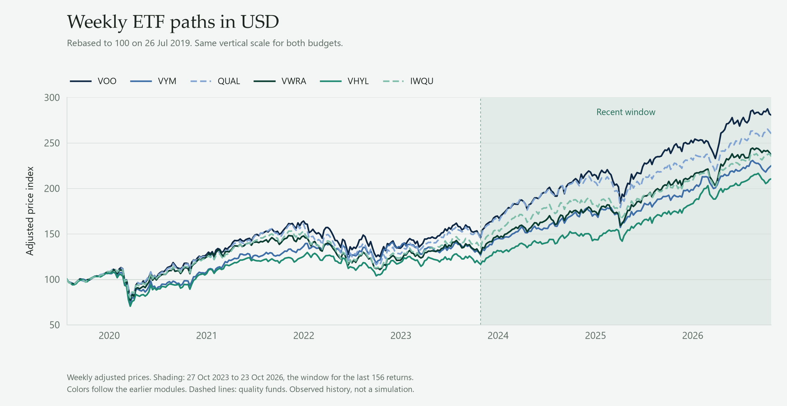
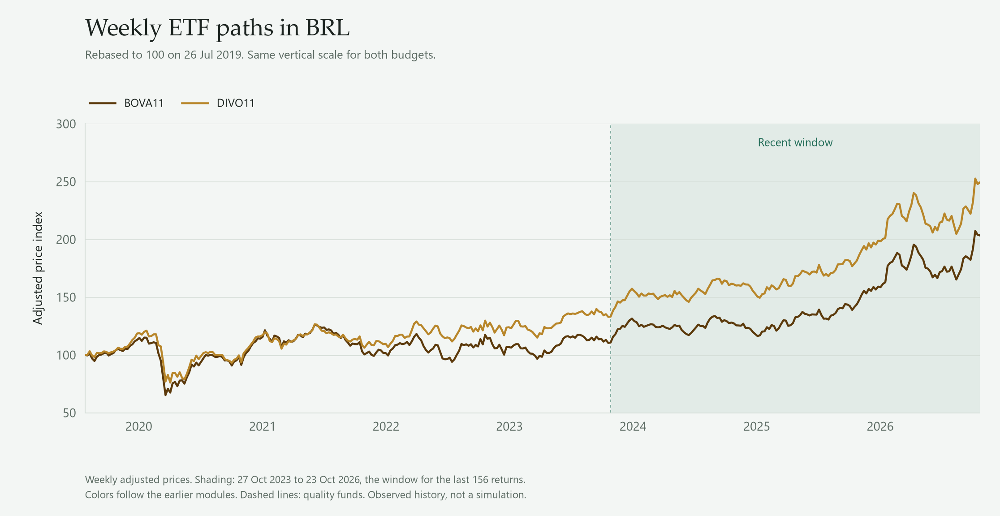
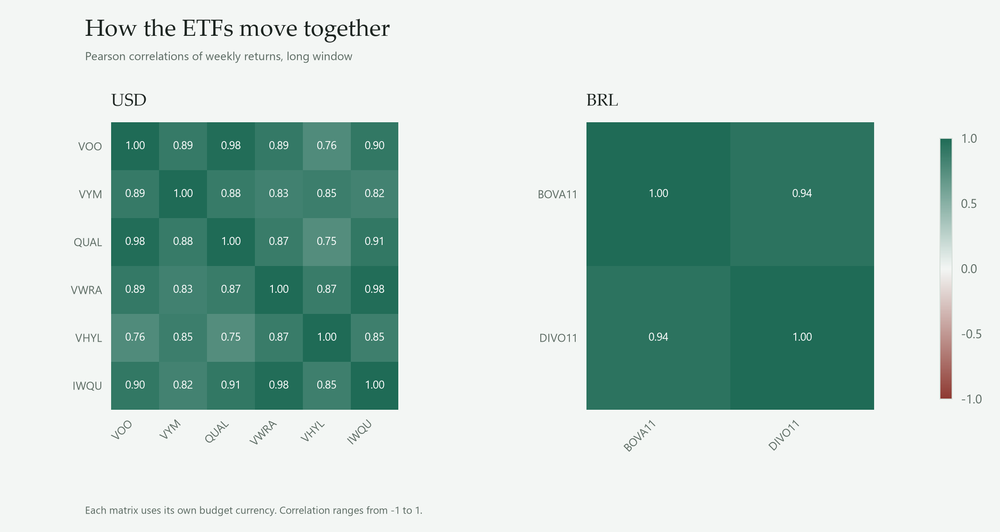
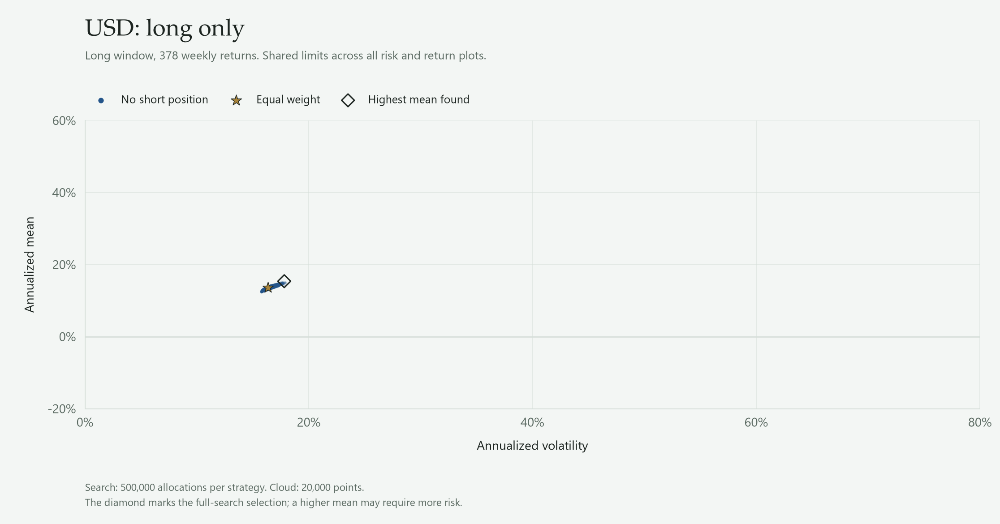
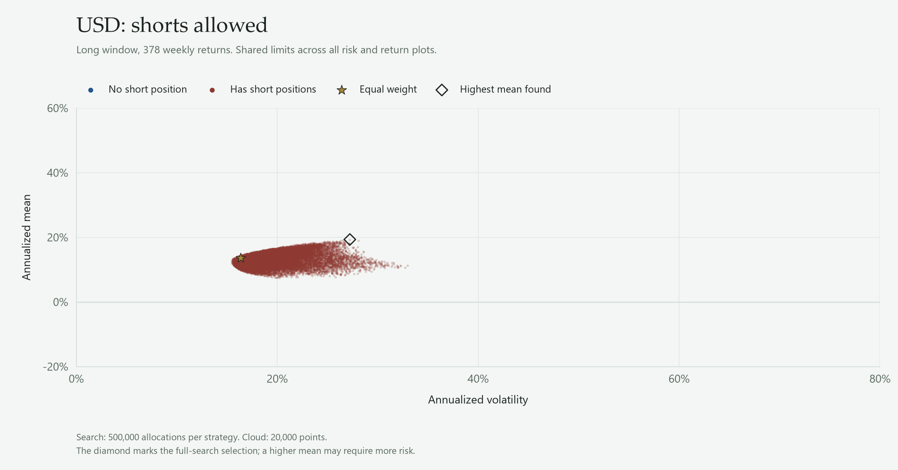
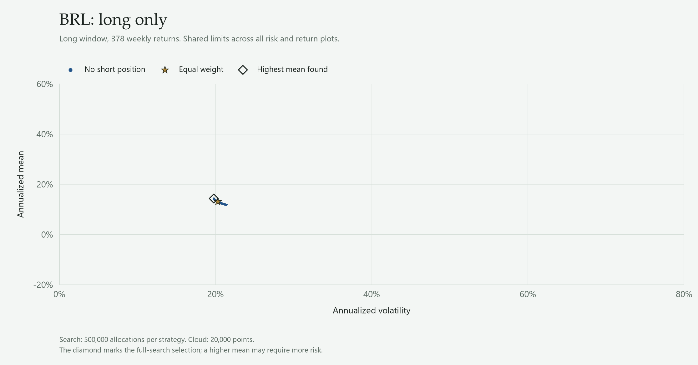
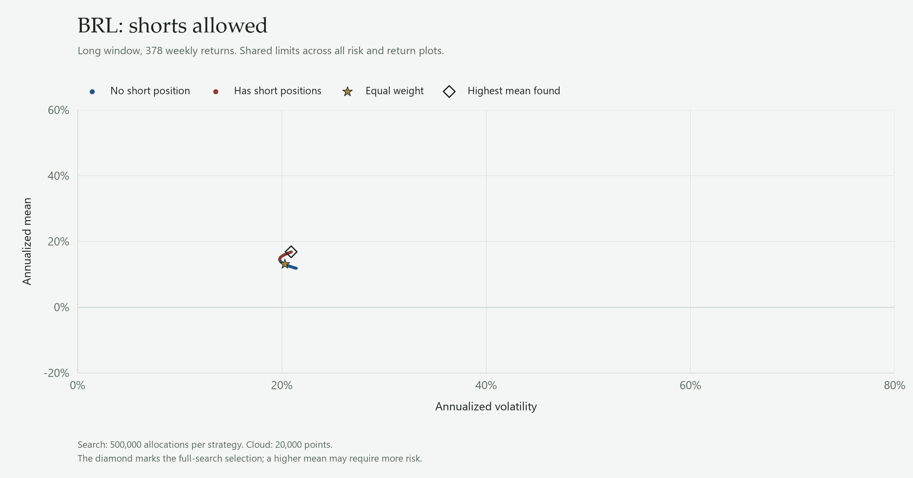
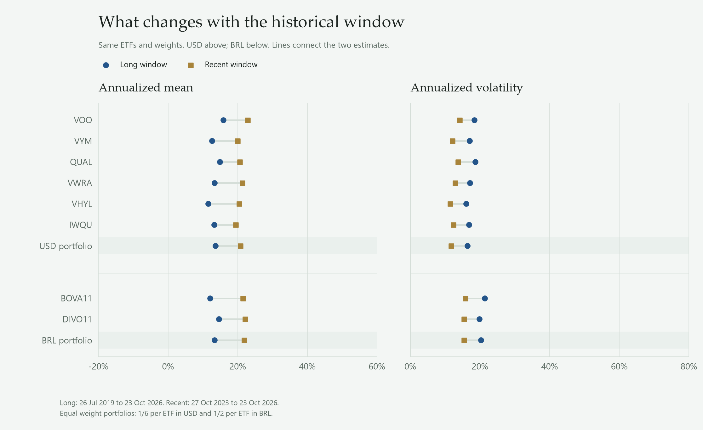
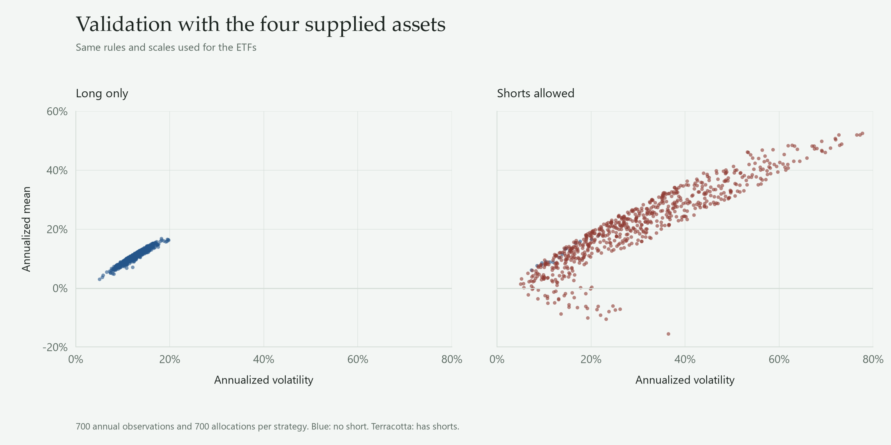

<header class="mast">
<dl class="facts">

<dt>University</dt><dd>Northwestern University</dd>

<dt>Student</dt><dd>Leandro Loli</dd>

<dt>Course</dt><dd>MSDS 451, Section 001</dd>

<dt>Term</dt><dd>Fall 2026</dd>

<dt>Date</dt><dd>October 25, 2026</dd>

</dl>
<h1>Portfolio Allocation with Monte Carlo</h1>

Financial Engineering, Programming Assignment 2

</header>

**Abstract.** I study eight ETFs in two separate budgets: six international ETFs in USD and two Brazilian ETFs in BRL. The original weight rule is used in every case. In the long window, allowing short sales increases the highest simulated mean by {{gain_usd}} in USD and {{gain_brl}} in BRL, with higher associated volatility. Changing the historical window also changes asset and portfolio estimates. These are results fitted to the observed samples, before trading and financing costs.

## 1. Objective

The study asks two questions: what changes when short sales are allowed, and how does the historical window affect the result?

The analysis uses the course's Monte Carlo procedure [1]. The second tests sensitivity to the model's historical inputs. The required run with the four supplied assets is reported in Appendix A. Each ETF budget has weights that sum to 100%. The study does not choose the overall split between USD and BRL.

## 2. Data and method

### 2.1. Assets and periods

The six international ETFs are the main application. The two Brazilian ETFs are an additional case.

{{asset_list}}

Adjusted prices were downloaded from Yahoo Finance through yfinance on {{download_date}}. These prices include the vendor's split and distribution adjustments. Distributions are not added again.

Brazilian holdings remain in BRL. VHYL.L is quoted in GBP and is converted to USD with GBP/USD. The other selected international listings are quoted in USD [3, 4]. A USD quote does not remove the underlying investments' currency exposure.

I use the last available price in each week and label it with Friday's date. Returns require consecutive weekly observations. Prices are not created before inception or across empty weeks. Both budgets use the same dates:

- **Long price window:** {{period_long}}.
- **Recent price window:** {{period_recent}}.

The recent window is the final 156 weekly returns of the long window, about three years. The windows overlap, so this is a sensitivity comparison rather than an independent experiment.

The weekly paths below put every ETF at 100 on the same starting date. The shaded area marks the recent window. These are observed adjusted price paths, not Monte Carlo simulations. USD and BRL remain separate.

### 2.2. Combining the assets

Portfolio return is the sum of asset returns multiplied by their weights:

$$r_{p,t}=\sum_{i=1}^{n}w_i r_{i,t}$$

Portfolio mean and volatility use asset means and the covariance matrix [1, 5]:

$$\mu_p=w^{\mathsf{T}}\mu$$

$$\sigma_p=\sqrt{w^{\mathsf{T}}\Sigma w}$$

For the ETFs, weekly means and covariances are annualized as follows:

$$\hat{\mu}_{\mathrm{annual}}=52\overline{r}_{\mathrm{weekly}}$$

$$\hat{\Sigma}_{\mathrm{annual}}=52\hat{\Sigma}_{\mathrm{weekly}}$$

Annual volatility is the weekly standard deviation multiplied by the square root of 52. This uses the square-root-of-time convention. The annualized arithmetic mean is not CAGR or a return forecast.

### 2.3. Simulation rules

For each ETF sample, I generate {{n_etf_returns}} joint annual normal return observations from its historical means and covariances. I then evaluate {{n_portfolios}} allocations per strategy, using moments of those simulated returns. Two budgets and two windows give four million allocations.

I use the weight construction supplied in the exercise. For **long only**, I draw a uniform number between 0 and 1 for each asset and divide by their sum. With **shorts allowed**, I draw the first weights between -1 and 1 and set the final weight to one minus their sum. Weights sum to 100%, with no added gross exposure or volatility ceiling.

The final asset has a distinct role in this rule. IWQU is last in USD and DIVO11 in BRL. The order is fixed, and possible exposure depends on asset count. This asymmetry follows the supplied method.

For the first question, the summaries show the highest simulated mean found and its corresponding volatility. The shorts-allowed summary may also choose a long only allocation. These are sampled outcomes, not exact optima.

For the second question, the reference keeps equal weights in both windows: one-sixth per USD ETF and one-half per BRL ETF. The allocation searches also reuse the same candidate weights across windows. These searches use simulated annual returns; the fixed-weight window tables use historical weekly returns.

## 3. Results

<h3 id="question-1">3.1. What changes when short sales are allowed?</h3>

Asset rows and portfolio summaries use the same simulated return sample. Portfolio risk uses weights and covariances, not a sum of asset volatilities. Equal weight is a reference. Each strategy summary shows its highest sampled mean and the volatility of that allocation.

**Six international ETFs in USD.** Price window: {{period_usd_long}}.

{{strategy_usd_long}}

**Two Brazilian ETFs in BRL.** Price window: {{period_brl_long}}.

{{strategy_brl_long}}

Delta is shorts allowed minus long only, in percentage points. The label n/a means not applicable. Asset rows have no strategy delta because permission to short is a portfolio choice.

In the long window, the mean difference is {{gain_usd}} for USD and {{gain_brl}} for BRL. The associated volatility differences are {{risk_change_usd}} and {{risk_change_brl}}. A higher mean therefore comes with a risk change; this is not a comparison at equal risk.

Each point is one allocation. Compare strategies within each case. The two currency budgets are not a single investment ranking.

All mean and volatility plots use the same limits: 0% to 80% for volatility and -20% to 60% for mean return. The weekly price indices use their own common base-100 scale. Correlations range from -1 to 1.

<h3 id="question-2">3.2. Does the historical window change the result?</h3>

Assets and currency stay fixed. Equal weights also stay fixed in the portfolio summaries. Delta is recent minus long, in percentage points.

**International ETFs and portfolio in USD**

**Annualized mean**

{{window_usd_mean_return}}

**Annualized volatility**

{{window_usd_volatility}}

**Brazilian ETFs and portfolio in BRL**

**Annualized mean**

{{window_brl_mean_return}}

**Annualized volatility**

{{window_brl_volatility}}

The USD equal weight mean rises from {{equal_usd_mean_return_long}} to {{equal_usd_mean_return_recent}}, while volatility falls from {{equal_usd_volatility_long}} to {{equal_usd_volatility_recent}}. In BRL, the mean rises from {{equal_brl_mean_return_long}} to {{equal_brl_mean_return_recent}}, while volatility falls from {{equal_brl_volatility_long}} to {{equal_brl_volatility_recent}}.

The recent window has higher means and lower volatilities for all eight ETFs and both reference portfolios in this sample.

Repeating the strategy search shows how this affects the first answer:

**Highest simulated means**

{{strategy_windows_mean}}

**Volatilities of those same allocations**

{{strategy_windows_volatility}}

Here delta again means shorts allowed minus long only. Both the mean difference and its associated risk change with the window, even with the same assets, rules and candidate weights. More simulations cannot remove dependence on historical inputs.

## 4. Conclusions and limits

Allowing short sales expands the sampled choices and raises the highest simulated mean in these cases, together with higher volatility. The calculations exclude trading, financing, borrowing costs and investor taxes. Fund expenses already reflected in prices are not deducted again.

The historical window changes individual and portfolio estimates. It also changes the return and risk differences between strategies. A conclusion about allocation therefore needs to state its assets, currency, dates and constraints.

This is an in-sample study. Estimates can change, portfolios can be concentrated, and volatility is not a maximum loss. Monte Carlo explores many allocations but does not prove an exact optimum. Testing on later data with costs would be needed before using a selected rule for investment decisions.

## 5. Reproduction and supporting details

The Python scripts run from saved data with <code>python run.py</code>. The README explains installation and checks. Tables are generated from saved results. <code>selected_portfolios.csv</code> records selected weights, <code>strategy_comparison.csv</code> records strategy differences, and <code>window_comparison.csv</code> records window differences.

Selected weights and search stability

Correlations enter the risk calculation. Several funds with similar movements need not provide independent sources of diversification.

**Weights of the highest-mean sampled allocations**

{{weights}}

Gross exposure is the sum of absolute weights. Displayed weights are rounded; CSV files retain calculation precision.

**Change from a larger search**

{{search_stability}}

These rows compare the first 50,000 allocations with all 500,000 from the same random sample. They assess search stability, not forecasting ability.

Long only weights are normalized uniform draws. For shorts, the first weights are uniform from -1 to 1 and the final weight is the residual. Clouds display 20,000 points per strategy; selections use the full search. An individual asset can have a higher mean than the best randomly generated long only portfolio, since finite random draws need not reach a full holding.

The ETF results use {{n_etf_returns}} annual normal return observations per sample. Seeds are saved in the configuration. Python and R do not produce identical observations from the same integer seed in the professor's reproduction.

## Appendix A. Supplied four-asset validation

The assignment requires two sets of initial conditions [2]. This check retains the supplied parameters and uses the same program applied to the ETFs.

The reproduction preserves the professor's four hypothetical assets:

{{teacher_inputs}}

A has correlation 0.30 with each other asset. B, C and D have mutual correlations of 0.60. I generate 700 joint annual return observations and 700 allocations per strategy. The result tables use moments from the simulated return sample, which differ slightly from the target inputs.

**Reproduction results**

{{strategy_teacher}}

This run checks the method. Its results are not used to rank the ETFs.

## References

1. Miller, Tom. 2025. *Portfolio Optimization: A Monte Carlo Study*. Course report and R program. [Course material](https://canvas.northwestern.edu/courses/260285/pages/module-5-portfolio-optimization-a-monte-carlo-study).
2. Northwestern University. 2026. *Module 5: Programming Assignment 2*. MSDS 451. [Instructions](https://canvas.northwestern.edu/courses/260285/assignments/1818437).
3. Vanguard. *FTSE All-World High Dividend Yield UCITS ETF*. [Fund page](https://www.vanguard.co.uk/professional/product/etf/equity/9506/ftse-all-world-high-dividend-yield-ucits).
4. London Stock Exchange. *VHYL: GBP quotation*. [Exchange page](https://www.londonstockexchange.com/stock/VHYL/vanguard/company-page).
5. CFA Institute. 2026. *Principles of Asset Allocation*. Mean variance analysis and 1/N. [Reading](https://www.cfainstitute.org/insights/professional-learning/refresher-readings/2026/principles-asset-allocation).
6. Yahoo Finance through [yfinance](https://ranaroussi.github.io/yfinance/). Adjusted prices and FX downloaded on {{download_date}}. <code>data/sources.json</code> records source metadata and file hashes.
